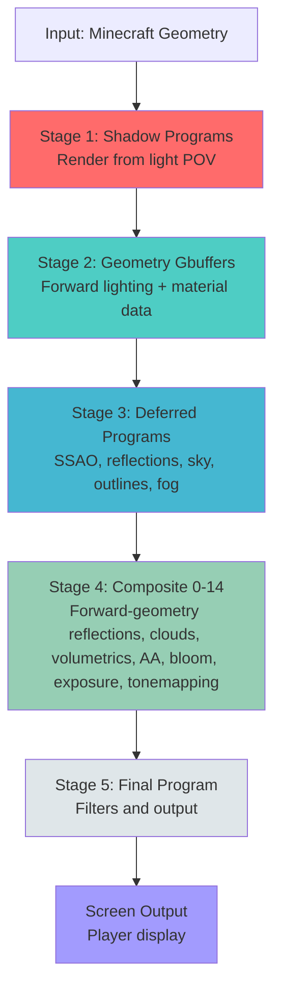
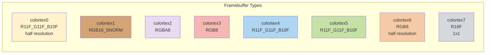

# Pipeline Architecture

**Scope**: Core architectural overview, framebuffer design, rendering flow  
**Related Docs**: [PROGRAMS.md](PROGRAMS.md) | [BUFFERS.md](BUFFERS.md) | [FEATURES.md](FEATURES.md) | [DIMENSION.md](DIMENSION.md)

---

## Table of Contents

1. [Quick Reference](#quick-reference)
2. [Pipeline Overview](#pipeline-overview)
3. [Framebuffer Architecture](#framebuffer-architecture)
4. [Rendering Pipeline Flow](#rendering-pipeline-flow)
5. [Pack-Level Configuration](#pack-level-configuration)
6. [Formatting Standards](#formatting-standards)

---

## Quick Reference

### Essential Numbers

| Metric | Value | Notes |
|--------|-------|-------|
| Color Targets | 8 | `colortex0` to `colortex7`; `colortex0` and `colortex6` are half width and half height, `colortex7` is a single texel |
| Rendering Stages | 5 | Shadow → Gbuffers → Deferred → Composite → Final |
| Deferred Programs | 2 | `deferred` (SSAO) and `deferred1` |
| Composite Programs | 15 | `composite` and `composite1`–`composite14`; some are conditional |
| GLSL Version | 3.3 Compatibility | 3.3 Core for `gbuffers_line` only |
| Maximum Shadow Resolution | 8192 | Shader menu slider domain |
| Half-Resolution Targets | `colortex0`, `colortex6` | Volumetrics/bloom intermediates and volumetric history |
| Dimension Folders | 7 | `world0`, `world-1`, `world1`, `world-2`, `world-3`, `world-4`, and the wildcard `world999` |
| Dimension Options | 59 per `world.glsl` | Every dimension exposes the same option set; see [DIMENSION.md](DIMENSION.md) |

### Quick File Map

| What to Find | Location |
|---|---|
| Pipeline flow diagram | [Pipeline Overview](#pipeline-overview) |
| Framebuffer formats & usage | [BUFFERS.md](BUFFERS.md) |
| All rendering programs | [PROGRAMS.md](PROGRAMS.md) |
| How features work | [FEATURES.md](FEATURES.md) |
| Macro settings | [SETTINGS.md](SETTINGS.md) |
| Custom uniforms and pack properties | [Pack-Level Configuration](#pack-level-configuration) |
| Dimension configuration (`world.glsl`, resolver, adapters) | [DIMENSION.md](DIMENSION.md) |

---

## Pipeline Overview

Super Duper Vanilla uses a **hybrid deferred/forward rendering approach** that balances Minecraft's entity/particle system with PBR visual quality. Direct lighting and shadow-map sampling are computed forward in the gbuffers programs; the deferred stage handles ambient occlusion, reflections, sky, outlines, and fog.

### Rendering Flow



### Architectural Principles

1. **Performance First**: Optimize where possible and minimize resource use; quality is secondary
2. **Hybrid Forward/Deferred Rendering**: Gbuffers programs compute direct lighting forward and also store normals, albedo, and material data for the deferred stage
3. **Ordered Composite Passes**: Passes execute in order with explicit target dependencies; not every pass reads only its predecessor's output
4. **Feature Modularity**: Individual features toggle via preprocessor macros in `settings.glsl`; programs that are not needed are disabled in `shaders.properties`
5. **World-Aware Rendering**: Each dimension folder (`world-X/`) wraps the same main programs and supplies its own `world.glsl` with the same full option set. Shared code reads those options only through the resolver and adapters, never through a dimension's own prefix. See [DIMENSION.md](DIMENSION.md)
6. **Target Reuse**: Iris is limited to 16 render targets, so lanes are intentionally multipurposed across the frame; `colortex0` and `colortex6` are configured at half width and height for reduced-resolution work

### Composite Passes

Composite programs run after deferred shading and use explicit buffer dependencies. The detailed pass responsibilities and enable conditions are maintained in [PROGRAMS.md](PROGRAMS.md). Volumetric lighting uses `colortex0` and keeps history in `colortex6`; bloom later reuses `colortex0`; auto exposure state lives in `colortex7`.

### World Configuration Layer

Per-dimension behavior reaches the shared programs through four layers:

| Layer | File | Role |
|---|---|---|
| Values | `world-X/world.glsl` | Defines `WORLD_ID`, `WORLD_PREFIX`, and every option with a dimension prefix (`WORLD0_`, `WORLDn1_`, `WORLD1_`, `WORLDn2_` to `WORLDn4_`, `WORLD999_`). The prefix keeps each option distinct for the Iris menu |
| Resolver | `lib/dimension/worldResolver.glsl` | Maps unprefixed names such as `WORLD_LIGHT` to the active dimension's prefixed option |
| Adapters | `lib/dimension/*Adapter.glsl` | Turn the resolved options into colors, densities, and intensities for the shaders |
| Consumers | `main/` and `lib/` | Read only the unprefixed names and adapter functions |

Rules for consumers:
- Feature flags are `0` or `1` values, so test them with `#if WORLD_X == 1`, never `#ifdef`.
- `dayCycle`, `twilightPhase`, and `dayCycleAdjust` are only declared when `WORLD_DAYCYCLE` is `1`, and `rainStrength` only when `WORLD_WEATHER` is `1`. Guard any use of them the same way.
- Adapter color functions return **linear** colors. Each time-of-day endpoint is converted to linear space before blending, so day cycle transitions blend in linear space. Do not wrap their output in `toLinear()`.

---

## Framebuffer Architecture

### 8-Target Configuration
Super Duper Vanilla uses eight color targets. Their formats, contents, and read/write lanes are documented in [BUFFERS.md](BUFFERS.md).



`colortex0` and `colortex6` are allocated at `0.5 × 0.5` in `shaders.properties`, so each contains one quarter as many pixels as a full-resolution target. Total VRAM depends on render resolution, target formats, depth targets, and shadow-map settings; a fixed memory estimate is not given here.

### Buffer Details

| Buffer | Format | Current use | Resolution / lifecycle |
|--------|--------|-------------|-----------------------|
| **colortex0** | R11F_G11F_B10F | Volumetrics, then bloom intermediates; cloud map is bound here for selected programs | Half width and half height; reused across passes |
| **colortex1** | RGB16_SNORM | Surface normals | Full view dimensions |
| **colortex2** | RGBA8 | Albedo and SSAO data | Full view dimensions |
| **colortex3** | RGB8 | Metallic, smoothness, and shading mask; later post-processed color | Full view dimensions; reused across stages |
| **colortex4** | R11F_G11F_B10F | HDR scene color | Full view dimensions |
| **colortex5** | R11F_G11F_B10F | Previous-frame scene color for TAA, SSR, and SSGI | Full view dimensions; history persists when used |
| **colortex6** | RGB8 | Volumetric-light history | Half width and height; read and written by `composite2` |
| **colortex7** | R16F | Auto exposure state | Single texel; updated by `composite13` |

### Depth Textures (Alongside Color Buffers)

| Texture | Purpose |
|---------|---------|
| `depthtex0` | Depth including translucent geometry |
| `depthtex1` | Depth without translucent geometry (used by DOF and water depth effects) |
| `shadowtex0` | Shadow map from the light's point of view (from shadow programs) |
| `shadowtex1` | Shadow depth without translucent casters (with colored shadows) |
| `shadowcolor0` | Colored shadow and caustics data (with colored shadows) |

Distant Horizons and Voxy add their own LOD depth textures; see [BUFFERS.md](BUFFERS.md) for the read/write lane map, target lifetimes, and attachment side lanes.

---

## Rendering Pipeline Flow

### Stage 1: Shadow Programs

**Purpose**: Render scene geometry from the light source's perspective to create the shadow map

**Characteristics**:
- Single ortho-projected render pass with a distortion function that favors nearby geometry
- Renders from the sun or moon viewpoint
- Output: `shadowtex0` and, with colored shadows, `shadowtex1` and `shadowcolor0`
- Sampled by forward-shaded gbuffers programs and by the volumetric pass (`composite1`)
- Disabled when `SHADOW_MAPPING` is off or the world has no `WORLD_LIGHT`
- Resolution and distance are controlled by `shadowMapResolution` and `shadowDistance`

See [PROGRAMS.md](PROGRAMS.md) for the shadow program list and responsibilities.

### Stage 2: Geometry Rendering (Gbuffers)

**Purpose**: Render Minecraft geometry while writing forward-lit scene color and G-buffer data

**Characteristics**:
- Programs run in three groups: before deferred (solid), mixed (forward-shaded geometry), and before composite (translucent and special)
- Writes the HDR scene (`colortex4`), and for most complex programs normals, albedo, and material data (`colortex1`–`colortex3`)
- Complex programs perform direct lighting and shadow sampling in the same pass
- Handles entities, particles, blocks, weather, and LOD terrain (Distant Horizons and Voxy)
- With TAA (`ANTI_ALIASING == 2`), most vertex shaders apply an 8-sample projection jitter
- Program ordering is defined by the shader pipeline; see [PROGRAMS.md](PROGRAMS.md)

See [PROGRAMS.md](PROGRAMS.md) for the geometry program list, classifications, and render order.

### Stage 3: Deferred Programs

**Purpose**: Compute screen-space ambient and reflection effects

**Characteristics**:
- `deferred`: SSAO into the alpha of `colortex2`; skipped for sky, hand, and pixels without normals
- `deferred1`: sky, SSR and SSGI reflections, outlines, SSAO application, and fog
- Operates on G-Buffer data produced by the Gbuffers stage
- Reads: normals, albedo, material data, depth, previous-frame color
- Writes: SSAO data and the HDR scene

See [PROGRAMS.md](PROGRAMS.md) for deferred program details.

### Stage 4: Composite Programs (Sequential Pipeline)

**Purpose**: Finish forward-shaded geometry, then apply volumetrics, anti-aliasing, motion blur, depth of field, bloom, exposure, and tone mapping

**Characteristics**:
- 15 named composite programs (`composite`/0 through `composite14`)
- Programs execute in pipeline order, but not every pass consumes the immediately preceding target
- `composite` applies reflections and fog to forward-shaded geometry and draws voxel clouds
- `composite1` ray-marches half-resolution volumetrics, `composite2` accumulates them over time, and `composite3` applies them to the HDR scene
- `composite4` runs TAA, `composite5` runs FXAA on the HDR scene
- `composite13` updates auto exposure and `composite14` produces the final tonemapped color in `colortex3`
- See [PROGRAMS.md](PROGRAMS.md) for per-pass roles and enable conditions

**Data Flow**:
```
Gbuffers / Deferred → Composite0 (forward geometry + clouds) → Composite1 (volumetric ray march) → Composite2 (temporal accumulation) → Composite3 (upsample and apply) → Composite4 (TAA) → Composite5 (FXAA) → Composite6 (motion blur) → Composite7 (DOF) → Composite8-11 (bloom + lens flare) → Composite12 (apply bloom) → Composite13 (auto exposure) → Composite14 (tonemapping) → Final Program
```

### Stage 5: Final Program

**Purpose**: Apply final filters and output to screen

**Characteristics**:
- Single full-screen pass reading `colortex3`
- Applies the retro filter, chromatic aberration, and optional sharpening
- Outputs to screen
- Also declares the buffer formats and clear flags for the whole pack
- Typically lightweight

**Program**: `final`

---

## Pack-Level Configuration

Pack-wide behavior is configured in `shaders/shaders.properties`, not in the shader programs.

### Pipeline Properties

| Property | Value | Effect |
|---|---|---|
| `vignette`, `oldLighting`, `underwaterOverlay` | `false` | Vanilla effects are disabled |
| `separateAo` | `true` | Vanilla AO is passed through vertex alpha |
| `rain.depth` | `false` | Rain does not write depth |
| `particles.ordering` | `after` | Particles render after deferred (Iris) |
| `separateEntityDraws` | `true` | Entities are drawn separately (Iris) |
| `sky`, `stars` | `false` | Vanilla sky and stars are disabled; the shader renders its own |
| `sun`, `moon` | `false` unless `SUN_MOON_TYPE == 2` | Vanilla sun and moon only when selected |
| `dhClouds`, `dhShadow.enabled` | `off`, `false` | Distant Horizons clouds and shadows are disabled |
| `shadowBlockEntities`, `shadowEntities` | `false` when the matching setting is off | Entity shadow toggles |
| `blend.*` | Mostly `off` | Blending is disabled for performance except additive and translucent programs |
| `alphaTest.*` | `off` | Alpha testing is done manually with `ALPHA_THRESHOLD` |

### Custom Uniforms

Uniforms computed in `shaders.properties` and available to every program:

| Uniform | Meaning |
|---|---|
| `halfViewWidth`, `halfViewHeight` | Half of the view size, floored (integers) |
| `halfPixelWidth`, `halfPixelHeight` | Reciprocal of the half view size |
| `pixelWidth`, `pixelHeight` | Reciprocal of the view size |
| `camPosDelta` | Camera position minus previous camera position |
| `borderFar` | Border fog distance: `far`, or the Distant Horizons or Voxy render distance when active and the eye is not in water |
| `vertexFrameTime`, `fragmentFrameTime` | `frameTimeCounter`, or smoothed world time depending on `TIMELAPSE_MODE` |
| `celestialSinX` | Sine of the sun angle (smoothed in timelapse modes) |
| `shdFade` | Shadow fade near twilight: `min(abs(celestialSinX) * 2π, 1)` |
| `dayCycle` | `1 + celestialSinX` (`0` to `2`; below `1` is night) |
| `dayCycleAdjust` | `dayCycle - 0.5` clamped to `0`–`1` |
| `twilightPhase` | Smoothed twilight factor derived from `abs(celestialSinX)` |
| `isPrecipitationRain` | Smoothed rain wetness when in a rainy biome below Y 96 |
| `lightningFlash` | Lightning flash strength (`lightningBoltPosition.w`) |
| `frameMod` | `frameCounter % 8`, used as the TAA jitter index |
| `frameFract` | `frameCounter * 1.61803399`, used to rotate noise per frame |
| `eyeSkylight` | Smoothed player sky light, `0` to `1` |
| `darkEffectFactor` | Blindness and Darkness effect strength |
| `cloudDistantFar` | Cloud render distance, shortened in rain |

Custom textures: `texture.noise = textures/noise.png` is always bound; `textures/clouds.png` is bound to `colortex0` for the `composite` and `deferred` stages when `CLOUD_TYPE != 0`.

---

## Formatting Standards

Maintain consistency across all shader code:

- **Priority**: Optimize where possible and minimize resource use; quality is secondary
- **Code Style**: Follow [CONTRIBUTION.md](../CONTRIBUTION.md): no spaces around parentheses, `SCREAMING_CASE` for defined macros only, `camelCase` for everything else, and a space after `//` or `/*`
- **Documentation**: Add comments when necessary
- **Testing**: Test shader changes before submitting a pull request
- **GLSL Version**: GLSL 3.3 Compatibility (exception: `gbuffers_line` uses 3.3 Core)

---

## References

- **[GLSL 3.30 Specification](https://registry.khronos.org/OpenGL/specs/gl/GLSLangSpec.3.30.pdf)** - Khronos language reference
- **[PROGRAMS.md](PROGRAMS.md)** - Detailed program reference
- **[BUFFERS.md](BUFFERS.md)** - Buffer system details
- **[LEGACY.md](LEGACY.md)** - Original design documentation