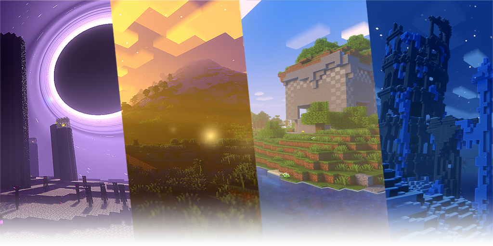
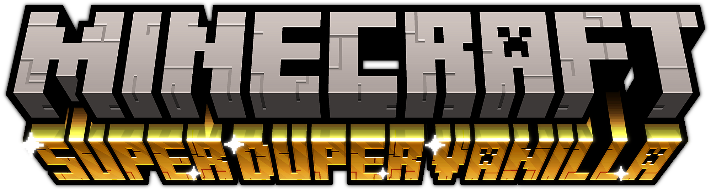
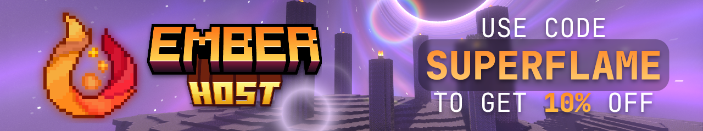

## Description
Super Duper Vanilla is a Minecraft shader pack created to convey the cancelled __Super Duper Graphics Pack__ and other popular Minecraft titles. Developed by [@Eldeston](https://github.com/Eldeston) and presented by __FlameRender Studios__.

## Shader Overview
SDV brings a PBR-focused take on Minecraft, pairing dynamic lighting with atmospheric effects and a deep set of visual options. Features include SSAO/SSR and experimental SSGI, voxel clouds and volumetric lighting, anti-aliasing, motion blur, depth of field, bloom, and tone mapping. See [Mod Compatibility](#mod-compatibility) for integrations.

For the rendering pipeline, settings, buffers, program map, and implementation references, see [DOCUMENTATION.md](DOCUMENTATION.md).

## Sponsored by BisectHosting

This shader is sponsored by **BisectHosting**. Open the image above or use the code [**FLAMERENDERSTUDIOS**](https://bisecthosting.com/FLAMERENDERSTUDIOS) to claim your discount to get ***25%*** off on your first month!

Choose **BisectHosting** to host a wide range of games including some of my personal favorites: **Minecraft, Terraria, and Project Zomboid**! ***65%*** of your first purchase will support the development of Super Duper Vanilla!

## Sponsored by Ember Host

This shader is sponsored by **Ember Host**. Open the image above or use the code [**SUPERFLAME**](https://billing.ember.host/aff.php?aff=23) to claim your discount to get ***10%*** off on your first purchase!

Choose **Ember Host** to host your Minecraft server and take advantage of their **powerful AMD processors** and go beyond with excellent prices! ***70%*** of your first purchase will support the development of Super Duper Vanilla!

## Screenshots

## License
This shader pack is distributed under the **FlameRender (C) Studios License**. See [LICENSE](LICENSE) for details.

## Contribution
If you plan to contribute to this project, see [**CONTRIBUTION**](CONTRIBUTION.md) for more info.

## Compatibility and Support
Current builds target Iris. The table summarizes the published Minecraft version and platform compatibility; OptiFine entries are retained from the older README table and are historical only.

| Loader | Minecraft version | Windows/Linux (Intel, AMD, NVIDIA) | Apple M1 |
|---|---|---|---|
| Iris 1.6.10+ | 1.18.2 and later | Supported | Supported |
| Iris | 1.17.1 and earlier | Not supported | Not supported |
| OptiFine (historical) | 1.17.1 and later | Partial support | Partial support |
| OptiFine (historical) | 1.14.2 and later | Partial support | Not supported |
| OptiFine (historical) | 1.13.2 and earlier | Not supported | Not supported |

OptiFine maintenance ended with SDV 1.3.7 and officialy incompatible by 1.4.0. Older AMD graphics drivers may show visual issues. Pojav Launcher use is unofficial, and results vary by device. For detailed compatibility notes, see [DOCUMENTATION.md](DOCUMENTATION.md).

## Mod Compatibility

SDV includes shader paths for several popular mods. Here is what those integrations cover:

| Mod | Integration in SDV |
|---|---|
| Distant Horizons | Dedicated programs for distant terrain, generic geometry, and water. |
| Voxy | Voxy depth inputs in rendering paths that support them. |
| Physics Mod | Ocean geometry and shadow rendering. |
| Astrocraft, Nuit | Low-priority visual issues. Will likely remain unimplemented. |

Missing a mod you use? Open an issue and link its project page. If you are adding support yourself, test the relevant paths and follow [CONTRIBUTION.md](CONTRIBUTION.md).

## Releases
Browse every release on the [GitHub releases page](https://github.com/Eldeston/Super-Duper-Vanilla/releases). Development builds live on their corresponding branches; switch to the branch you want, select **Code**, and choose **Download ZIP**.

Latest build and pre-release versions are expected to be unstable, please report any issues or bugs anytime. Feedback is much appreciated.

## Official Modrinth Page
Super Duper Vanilla just happens to be on Modrinth! Stable and latest releases will always be available there. Check it out [here](https://modrinth.com/shader/super-duper-vanilla) and support me by using any one of the download links there!

## Official CurseForge Page
Super Duper Vanilla is also on CurseForge! Stable and latest releases will always be available there. Check it out [here](https://www.curseforge.com/minecraft/customization/super-duper-vanilla-shaders) and support me by using any one of the download links there!

## Super Duper Vanilla Installer
Prefer an installer? The [Super Duper Vanilla Installer](https://github.com/steb-git/super-duper-vanilla-installer), developed by [@steb-git](https://github.com/steb-git), can install release or development builds. It is still a work in progress.

## Social Links
Come join the FlameRender Studios community on Discord to chat about SDV and other projects:
* [Flamerender Studios Discord](https://discord.gg/UE85W5ynCg)

Follow [@Eldeston on X](https://twitter.com/eldeston) or subscribe to the [YouTube channel](https://www.youtube.com/channel/UCQCkkFh25ydxZwCqpBhJJlg?view_as=subscriber) for development updates and new videos.

You can support the project through [PayPal](https://www.paypal.com/donate?hosted_button_id=4XLQ4WE296JKW), too.